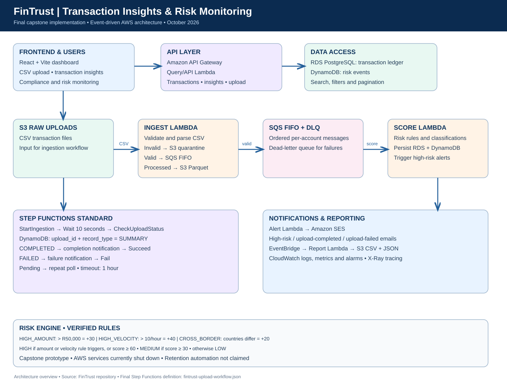

# FinTrust | Transaction Insights & Risk Monitoring System

**An AWS-based, event-driven transaction processing and rule-based risk monitoring prototype.**

**Solo capstone project** · **Built in four weeks (October 2026)** · **2nd place, 90/100**

> **Status:** Completed and demonstrated in October 2026. Cost-incurring AWS resources were subsequently shut down, so the hosted dashboard and API are not currently advertised as live. FinTrust continues as a software engineering portfolio project.

## Overview

FinTrust processes CSV transaction uploads, validates records, quarantines invalid data, evaluates defined risk rules, and stores transaction and risk information. A REST API and React dashboard provide access to the results. The system also supports high-risk email alerts, scheduled reporting and operational monitoring.

FinTrust is a **demonstration prototype**, not a live banking system. Its classifications are not fraud verdicts or automated compliance decisions. It does not use machine-learning fraud detection.

## Key features

- **CSV ingestion and validation:** Validates uploaded records and routes invalid data to Amazon S3 quarantine.
- **Asynchronous processing:** SQS FIFO separates ingestion from scoring; a dead-letter queue isolates repeatedly failing messages.
- **Rule-based risk scoring:** Evaluates transaction amount, account velocity and cross-border indicators.
- **Data persistence:** Uses RDS PostgreSQL for relational transaction records and DynamoDB for risk events and upload tracking.
- **Workflow orchestration:** AWS Step Functions tracks upload completion and failure through DynamoDB and triggers notification handling.
- **API and dashboard:** API Gateway and a React/Vite interface expose transaction and risk insights.
- **Alerts and reports:** Amazon SES sends notifications; EventBridge and Lambda support scheduled reporting.
- **Engineering practices:** CloudWatch monitoring, X-Ray tracing, pytest suites and GitHub Actions CI.

## Architecture



[Original capstone architecture diagram](docs/architecture/FinTrust%20Transaction%20Insights%20and%20Risk%20Monitoring%20System.jpg)

```text
CSV upload / API
       |
       v
   Amazon S3 (raw)
       |
       v
   Ingest Lambda --------> S3 quarantine (invalid records)
       |
       v
    SQS FIFO ----> DLQ (repeated failures)
       |
       v
   Score Lambda
       |  \
       |   +----> DynamoDB (risk events / tracking)
       +--------> RDS PostgreSQL (transactions / risk records)
       |
       +--------> Alert Lambda --> Amazon SES

React dashboard --> API Gateway --> API/Lambda handlers --> Data stores
EventBridge --> Report Lambda --> S3 reports
```

### Step Functions upload workflow

The **final deployed workflow** is represented by [`fintrust-upload-workflow.json`](fintrust-upload-workflow.json). It invokes ingestion, waits, and checks a DynamoDB upload-tracking record until processing reaches `COMPLETED` or `FAILED`. On completion, it invokes the alert Lambda with `UPLOAD_COMPLETED`; on failure, it invokes the alert Lambda with `UPLOAD_FAILED`. Notification failures are caught so the workflow can still reach its terminal state.

> The separate [`infrastructure/step-functions/upload-workflow.asl.json`](infrastructure/step-functions/upload-workflow.asl.json) is an earlier, simplified definition. It is **not** the final deployed notification workflow.

See the [architecture notes](docs/architecture/system-architecture.md) and [Well-Architected self-assessment](docs/architecture/well-architected-self-assessment.md).

## Technology stack

| Layer | Technologies |
| --- | --- |
| Frontend | React, JavaScript, Vite, CSS |
| Backend | Python, AWS Lambda |
| API | Amazon API Gateway, REST |
| Processing | Amazon S3, SQS FIFO, dead-letter queue, AWS Step Functions |
| Data | Amazon RDS PostgreSQL, Amazon DynamoDB |
| Notifications and reporting | Amazon SES, Amazon EventBridge, Amazon S3 |
| Operations and security | Amazon CloudWatch, AWS X-Ray, IAM, VPC, Systems Manager Parameter Store |
| Testing and CI | pytest, GitHub Actions |

## Risk assessment engine

The rules are implemented in [`backend/fintrust/score.py`](backend/fintrust/score.py):

| Rule | Condition | Points |
| --- | --- | ---: |
| `HIGH_AMOUNT` | Amount greater than R50,000 | +30 |
| `HIGH_VELOCITY` | More than 10 account transactions within one hour | +40 |
| `CROSS_BORDER` | Source and destination countries differ | +20 |

**Classification:** `HIGH` if `HIGH_AMOUNT` or `HIGH_VELOCITY` is triggered, or if the score is at least 60. Otherwise `MEDIUM` for scores of at least 30, and `LOW` below 30. Classification is **not based on score thresholds alone**.

These rules are illustrative and do not establish whether a transaction is fraudulent.

## API and dashboard

| Method | Route | Purpose |
| --- | --- | --- |
| GET | `/transactions` | Search, filter and paginate transaction records |
| GET | `/insights` | Retrieve aggregate transaction and risk insights |
| POST | `/upload` | Accept a CSV upload for asynchronous processing |
| POST | `/flag` | Flag an account or transaction for review |
| POST | `/resolve` | Resolve a review or risk event |

The dashboard source is in [`frontend/`](frontend/). API contracts and deployment configuration should be checked before attempting external integrations.

## Testing and CI

- [Unit tests](tests/unit/)
- [Integration tests](tests/integration/)
- [AWS end-to-end test](tests/e2e/)
- [GitHub Actions workflow](.github/workflows/ci.yml)

GitHub Actions runs unit tests on pushes and pull requests. Integration tests run on pushes to `develop` with a PostgreSQL service. The AWS end-to-end job is manually triggered and requires an active AWS environment and configured credentials.

Run unit tests locally after installing dependencies:

```bash
python -m pip install -r requirements.txt
python -m pytest tests/unit -v
```

## Security and operations

The design includes IAM execution roles, private RDS networking, encrypted storage, Systems Manager Parameter Store, application logs, metrics and alarms. The [Well-Architected self-assessment](docs/architecture/well-architected-self-assessment.md) documents design trade-offs and limitations.

**Production note:** FinTrust is a portfolio prototype, not a production-ready banking platform. Do not use real customer data or publish credentials.

## Repository structure

```text
fintrust-risk-system/
├── backend/fintrust/       # Python ingestion, scoring, persistence, API and reports
├── frontend/               # React/Vite dashboard
├── data/                   # SQL schema, seed files and demo data
├── deployment/             # Deployment-related files
├── infrastructure/         # AWS configuration and workflow definitions
├── docs/                   # Architecture, security, governance and presentation
├── evidence/               # Evidence folders; some awaiting curated assets
├── scripts/                # Supporting scripts
├── tests/                  # Unit, integration and end-to-end tests
├── .github/workflows/      # GitHub Actions CI
├── requirements.txt
└── README.md
```

## Getting started

Cloning this repository does **not** provision the AWS infrastructure or start the complete system. Full deployment requires AWS resources, permissions, database setup, configuration and API integration.

For local inspection and tests:

```bash
git clone https://github.com/SandeepHarii/fintrust-risk-system.git
cd fintrust-risk-system
python -m venv .venv
# Activate the virtual environment for your operating system
python -m pip install -r requirements.txt
python -m pytest tests/unit -v
```

For frontend development:

```bash
cd frontend
npm install
npm run dev
```

Live frontend features require appropriate backend API configuration. A complete reproducible deployment guide remains a future documentation improvement.

## Project outcome and current status

FinTrust was independently developed for an October 2026 cloud capstone and achieved **second place with a score of 90/100**. It demonstrates cloud architecture, Python backend development, React, relational and NoSQL data, event-driven processing, testing and observability.

After the capstone, cost-incurring AWS services were shut down to avoid unnecessary charges. The source code remains available for review. Future improvements will be tracked separately from the original capstone submission.

## Further documentation

- [Architecture overview](docs/architecture/system-architecture.md)
- [Well-Architected self-assessment](docs/architecture/well-architected-self-assessment.md)
- [Capstone presentation](docs/presentations/fintrust-presentation.html)
- [Frontend source](frontend/)
- [Automated tests](tests/)
- [Capstone AWS and testing evidence](evidence/README.md)
- [Testing and CI guide](docs/testing-and-ci.md)
- [Security review findings](docs/security/repository-review.md)
- [AWS reactivation checklist](docs/deployment/reactivation.md)

---

**Developed by Sandeep Hari** · [LinkedIn](https://www.linkedin.com/in/sandeep-harii) · [GitHub](https://github.com/SandeepHarii)
